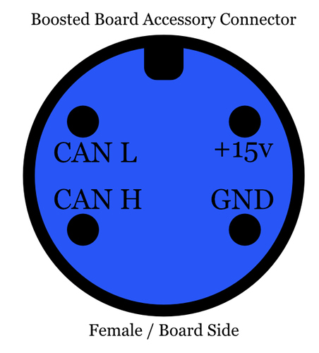

# Boosted Board XR RLOD Reset Utility

A Python script that communicates with a **Boosted Board XR electric scooter battery** over CAN bus to:

- **Reset RLOD (Ride Light Off / cell voltage imbalance) errors** — usually caused by cell voltage imbalance
- **Report cell voltages** — shows the voltage of every cell as reported by the TI Battery Monitor (AFE)
- **Generate a battery recharge report** — output can be parsed to identify the weakest cell(s) in the pack that consistently lag behind others

## What It Does

The script connects to the battery's CAN interface and:



*Image credit: [Saleae Forum — Hacking the Boosted Accessory Port](https://discuss.saleae.com/t/hacking-the-boosted-accessory-port/522)*

1. Waits for the battery to boot and start sending CAN messages
2. Enables message routing from the battery to the CAN bus
3. Sends periodic keep-alive messages so the battery thinks an ESC is connected
4. Listens for cell voltage data, then queries the battery via `GETAFECELLS`
5. Prints the lowest, highest, total, and delta between cells
6. If the cell delta is under 500mV, it sends `PFAILRESET` and `REBOOT` to clear the RLOD error
7. Outputs all data to stdout (redirectable to a file) for later analysis

> **⚠️ WARNING:** This script clears *all* faults. If a cell is severely out of spec (e.g. 1.5V), the reset may not fix the issue and the battery will return to RLOD on the next power cycle. Use at your own risk.

## Dependencies

### Python packages

```bash
pip3 install python-can
```

That's the only external dependency. All other modules (`argparse`, `sys`, `time`, `datetime`, `struct`) are part of the Python standard library.

### Hardware

- A **CAN-to-USB adapter** (slcan-compatible). Examples:
  - Any USB-to-CAN dongle with slcan firmware
  - An Arduino or ESP32 running slcan firmware
  - A Peak-PCAN, Kvaser, or similar adapter with slcan driver support
- A **Boosted Board XR battery** connected to the CAN bus via the adapter

Connect the adapter to your computer, note the device path (e.g. `/dev/ttyACM0` on Linux, `/dev/tty.usbmodem1101` on macOS), and pass it to the script.

## Hardware Connection

This section describes how to connect a Boosted Board XR battery to a CAN bus adapter for use with this script.

### Required Hardware

- **Boosted Board XR battery** (the source of CAN bus data)
- **CAN-to-USB adapter** (slcan-compatible), such as:
  - USB-to-CAN dongle with slcan firmware
  - Arduino or ESP32 running slcan firmware
  - Peak-PCAN, Kvaser, or similar adapter with slcan driver support
- **JST connector** matching the Boosted Board accessory port (typically JST GH 3-pin)

### Pinout

The Boosted Board XR accessory port exposes the CAN bus through a JST connector. Refer to the image above for the physical wiring.

| Pin | Signal | Description |
|-----|--------|-------------|
| 1 | CAN-H | CAN bus high (2.5V–3.5V differential) |
| 2 | CAN-L | CAN bus low (1.5V–2.5V differential) |
| 3 | GND | Ground reference |

### Wiring Steps

1. **Identify the accessory port** on the Boosted Board XR battery (a small JST connector on the side of the pack).
2. **Connect CAN-H** (pin 1) to the CAN-H pin on your USB-to-CAN adapter.
3. **Connect CAN-L** (pin 2) to the CAN-L pin on your USB-to-CAN adapter.
4. **Connect GND** (pin 3) to the ground pin on your adapter.
5. **Plug the adapter** into your computer via USB.
6. **Verify the device** appears at `/dev/ttyACM*` (Linux) or `/dev/tty.usbmodem*` (macOS).

> **⚠️ Warning:** Double-check your wiring before powering the battery. Reversing CAN-H and CAN-L will not damage the battery but will prevent communication. Connecting to the wrong pins may damage your adapter.

> **⚠️ Warning:** Ensure your CAN adapter supports **250 kbps** bitrate, which is the speed the Boosted Board XR battery uses on its accessory port.

## Usage

### Basic usage (Linux)

```bash
python3 -u boosted-rlod-fix-report.py -c /dev/ttyACM0
```

### Save output to a file for later analysis

```bash
python3 -u boosted-rlod-fix-report.py -c /dev/ttyACM0 >> xr_battery_datapoints.txt
```

The resulting `xr_battery_datapoints.txt` can be parsed to generate a battery recharge report by monitoring the voltage of each cell over time. Cells that consistently lag behind others are the weakest and may need replacement.

### Command-line options

| Flag | Description | Default |
|------|-------------|---------|
| `-i, --interface` | CAN interface type (python-can `bustype`) | `slcan` |
| `-c, --channel` | Serial port path of the CAN adapter | `/dev/tty.usbmodem1101` |
| `-p, --power-off` | Power off the battery when the script exits | (disabled) |

### Examples

```bash
# Linux — USB-to-CAN adapter on /dev/ttyACM0
python3 -u boosted-rlod-fix-report.py -c /dev/ttyACM0

# Linux — USB-to-CAN adapter on /dev/ttyUSB0
python3 -u boosted-rlod-fix-report.py -c /dev/ttyUSB0

# macOS — Arduino-based slcan adapter
python3 -u boosted-rlod-fix-report.py -c /dev/tty.usbmodem1101

# With output saved to a file
python3 -u boosted-rlod-fix-report.py -c /dev/ttyACM0 >> xr_battery_datapoints.txt

# Power off the battery after completing (advanced)
python3 -u boosted-rlod-fix-report.py -c /dev/ttyACM0 -p
```

### Using a different CAN interface type

If you're not using an slcan-based adapter (e.g. PCAN, SocketCAN, etc.), specify the interface type:

```bash
python3 -u boosted-rlod-fix-report.py -i socketcan -c can0
```

See the [python-can documentation](https://python-can.readthedocs.io/en/stable/configuration.html) for all supported interface types and configuration options.

## Original Source

Originally from [beambreak.org](https://beambreak.org) / [github.com/rscullin/beambreak](https://github.com/rscullin/beambreak)

Modified by @dalfry (VaibhaV Sharma) in 2026 to focus on RLOD reset and battery cell voltage reporting.

## License

MIT License — Copyright (c) 2023 Robert Scullin
